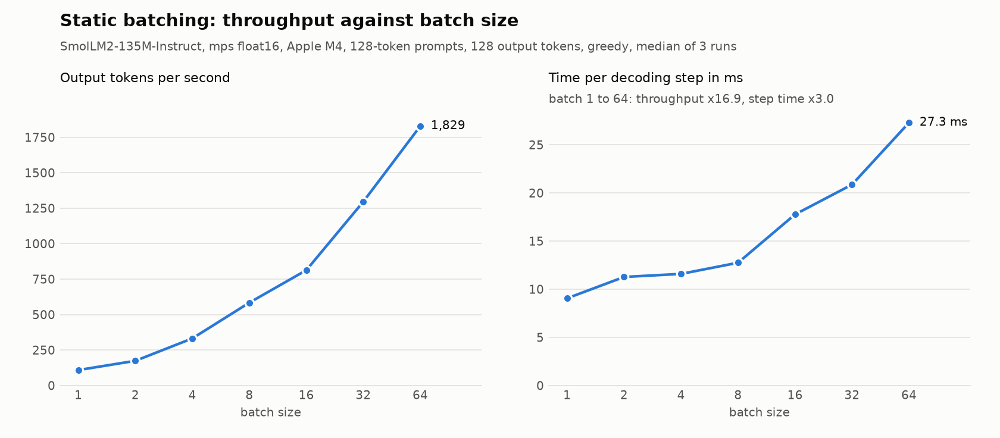
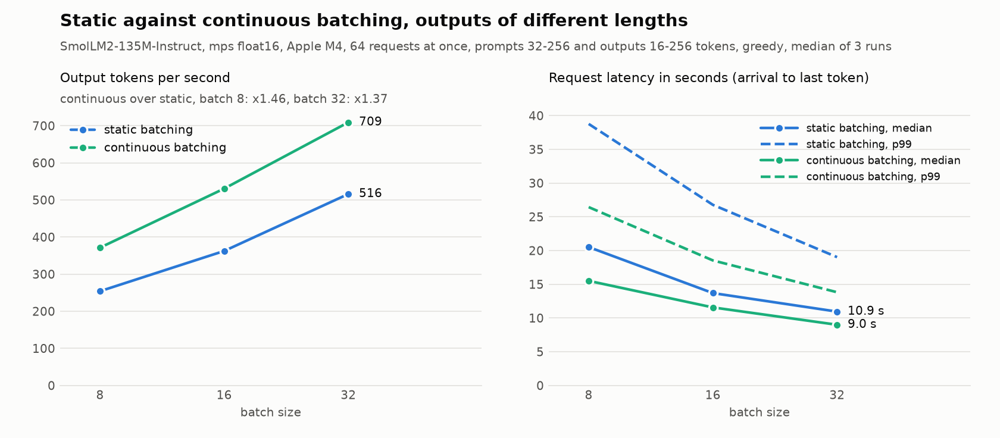
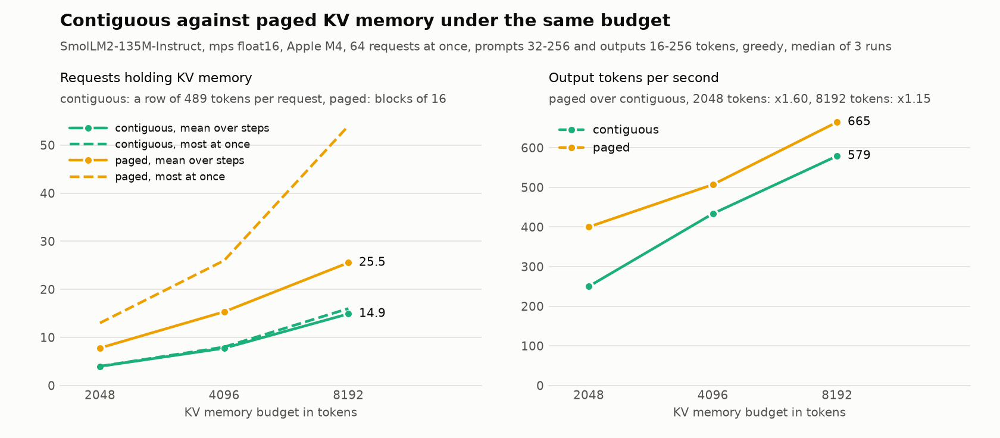
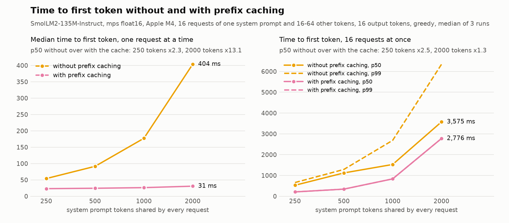
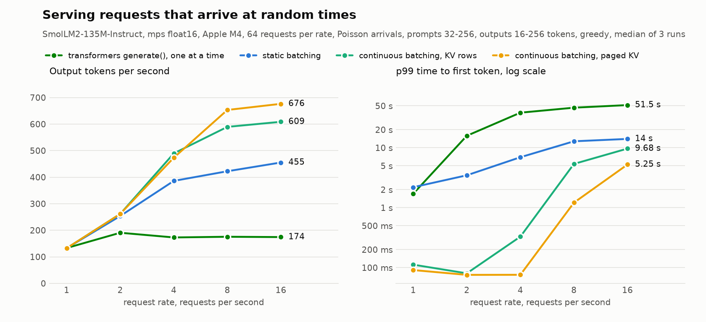

# Kiyal

Kiyal (Kyrgyz *кыял*, "dream") is an LLM inference engine and OpenAI-compatible server, built
from scratch in PyTorch.

## Status

Early development. Implemented so far:

- automatic device and dtype selection (CUDA, MPS or CPU)
- the Llama model: RMSNorm, rotary position embeddings, grouped-query attention and a SwiGLU MLP
- a strict safetensors loader for Hugging Face checkpoints, from a local directory or the Hub
- sampling with temperature, top-k, top-p, min-p, repetition, presence and frequency penalties,
  and per-request seeds, with settings batched per row
- streaming detokenization that never prints half a character, and stop strings matched across
  token boundaries
- a KV cache: the keys and values of every layer are kept in one preallocated tensor, so the
  prompt runs through the model once and each later step runs on a single new token
- static batching: prompts of different lengths are padded at the start into one batch, with the
  padding hidden from attention and positions counted per row, so each prompt gets the tokens it
  would get alone
- continuous batching: an engine with `add_request` and `step` whose scheduler rebuilds the batch
  at every step, first come, first served, within limits on sequences and tokens per step. A
  request leaves the batch as soon as its output ends and a waiting one takes its place. The
  tokens of all requests in a step run through the model flattened, without padding
- a paged KV cache: keys and values live in blocks of 16 tokens that a request takes as its
  output grows, listed in its block table, instead of a row reserved for the longest possible
  request. When the blocks run out, the newest request gives its blocks up and is computed
  again later (preemption by recompute). The pool is sized from free memory on CUDA and from a
  set size on the CPU and MPS
- prefix caching: each full block is known by a hash of its tokens and every token before them,
  so a request whose prompt starts like an earlier one, such as a shared system prompt, shares
  that request's blocks and runs only the rest of its prompt. Blocks that no request holds stay
  cached until their memory is needed, the least recently used first, and requests that start
  in the same step share the blocks the first of them computes
- `kiyal generate`, which streams text decoded with the KV cache. The loop that recomputes the
  whole sequence at every step is kept as the baseline for tests and benchmarks.
- an OpenAI-compatible HTTP server, `kiyal serve`: `/v1/completions` and `/v1/chat/completions`,
  streamed as server-sent events or not, `/v1/models`, `/health`, and Prometheus metrics at
  `/metrics`. The engine steps on a thread of its own, so the batch keeps moving while the
  server handles HTTP, and a request whose client disconnects is aborted and its KV blocks freed

On SmolLM2-135M-Instruct in fp32 on CPU, the model's logits match `transformers` within 1e-4, and
greedy generation for a chat prompt gives the same tokens as `transformers`' `generate()`. Decoding
with the KV cache gives the same tokens as decoding without it, and a static or continuous batch
gives each prompt the same tokens as decoding it alone, also when the paged cache preempts and
recomputes requests and when requests share cached prefixes. Requests sent to the server
together through the official `openai` client get the same text as well.

## Setup

Requires [uv](https://docs.astral.sh/uv/). uv installs Python 3.12 if it is missing.

```sh
git clone https://github.com/doublepunch31/kiyal.git
cd kiyal
uv sync --extra cpu
uv run kiyal --help
```

The `cpu` extra installs PyTorch's CPU-only build on Linux and the standard build on macOS, which
runs on Apple Silicon GPUs through MPS. An install option for NVIDIA GPUs will be added with the
first GPU benchmarks.

## Usage

```sh
uv run kiyal generate --model HuggingFaceTB/SmolLM2-135M-Instruct "What is the capital of France?"
```

The prompt is wrapped in the model's chat template and the reply is printed as it is generated.
The model is downloaded into the Hugging Face cache on first use (about 270 MB).

```sh
# Continue plain text instead, greedily, up to the first full stop.
uv run kiyal generate --model HuggingFaceTB/SmolLM2-135M-Instruct \
    --raw --temperature 0 --stop "." "The capital of France is"
```

`uv run kiyal generate --help` lists the sampling options.

### Serving

```sh
uv run kiyal serve --model HuggingFaceTB/SmolLM2-135M-Instruct --port 8000
```

```sh
curl http://localhost:8000/v1/chat/completions \
    -H "Content-Type: application/json" \
    -d '{"model": "HuggingFaceTB/SmolLM2-135M-Instruct",
         "messages": [{"role": "user", "content": "What is the capital of France?"}],
         "max_tokens": 64}'
```

With the `openai` client (installed with the development dependencies), streaming the reply:

```python
from openai import OpenAI

client = OpenAI(base_url="http://localhost:8000/v1", api_key="unused")
stream = client.chat.completions.create(
    model="HuggingFaceTB/SmolLM2-135M-Instruct",
    messages=[{"role": "user", "content": "What is the capital of France?"}],
    max_tokens=64,
    stream=True,
)
for chunk in stream:
    print(chunk.choices[0].delta.content or "", end="", flush=True)
```

Requests take OpenAI's `max_tokens`, `temperature`, `top_p`, `stop`, `seed`,
`presence_penalty`, `frequency_penalty`, `stream` and `stream_options`, with `n` = 1 only and no
`logprobs`, plus the engine's `top_k`, `min_p`, `repetition_penalty` and `ignore_eos` (through
`extra_body` in the `openai` client). Prompts of `/v1/completions` can be text or token ids.
Errors come back in OpenAI's format. `uv run kiyal serve --help` lists the batch and KV cache
options.

## Benchmarks

All numbers below were measured on a laptop (Apple M4): the KV cache, static batching, prefix
caching and serving runs on battery power, the continuous batching and paged cache runs on AC
power. None are NVIDIA GPU numbers.

### KV cache

One request with a 128-token prompt, decoded greedily with and without the KV cache.
SmolLM2-135M-Instruct in fp32 on a laptop CPU (Apple M4), median of 3 runs. These are not GPU
numbers.


| output tokens | KV cache tokens/s | naive tokens/s | KV cache total s | naive total s | speedup |
|---|---|---|---|---|---|
| 32 | 81.8 | 15.2 | 0.39 | 2.10 | 5.4 |
| 64 | 82.5 | 13.8 | 0.78 | 4.63 | 6.0 |
| 128 | 87.9 | 12.1 | 1.46 | 10.60 | 7.3 |
| 256 | 89.6 | 10.7 | 2.86 | 24.01 | 8.4 |
| 512 | 89.1 | 7.0 | 5.75 | 73.57 | 12.8 |
| 1024 | 85.3 | 3.9 | 12.01 | 260.45 | 21.7 |
| 2048 | 83.2 | 2.1 | 24.62 | 966.92 | 39.3 |

With the cache, total time doubles when the output doubles. Without it, every step runs the model
on the whole sequence, so total time follows the sum of the sequence lengths: doubling the output
multiplies it by 2.2 for short outputs, where the 128-token prompt is most of the sequence, and by
3.7 from 1024 to 2048 tokens, close to the factor of 4 of quadratic growth.

### Static batching

B different 128-token prompts decoded together, 128 greedy output tokens each, with the KV cache.
Batch sizes 1 to 64, median of 3 runs after one warm-up at each size. A step gives every prompt
its next token, so the step time is also each prompt's time per output token.

On the M4 GPU through MPS (fp16):



| batch size | output tokens/s | x batch 1 | step ms | x batch 1 | TTFT ms |
|---|---|---|---|---|---|
| 1 | 108.4 | 1.00 | 9.0 | 1.00 | 31 |
| 2 | 173.6 | 1.60 | 11.3 | 1.25 | 43 |
| 4 | 331.6 | 3.06 | 11.6 | 1.28 | 73 |
| 8 | 583.7 | 5.38 | 12.7 | 1.41 | 134 |
| 16 | 812.8 | 7.50 | 17.8 | 1.96 | 264 |
| 32 | 1295.9 | 11.95 | 20.9 | 2.31 | 511 |
| 64 | 1829.1 | 16.87 | 27.3 | 3.02 | 1012 |

Much of a decoding step's cost does not grow with the batch: every weight is read once per step,
and the fixed cost of running each layer is paid once. Up to batch 8, extra rows share that cost
almost for free: 8 times the tokens per step for a step 1.4 times as long. From batch 16 the step time grows faster, and
batch 64 gives 16.9 times the throughput of batch 1 for steps 3 times as long. The time to the
first token grows with the batch, because every prompt is prefilled before the first step.

On the CPU (fp32, 4 threads):

| batch size | output tokens/s | x batch 1 | step ms | x batch 1 | TTFT ms |
|---|---|---|---|---|---|
| 1 | 92.1 | 1.00 | 10.5 | 1.00 | 53 |
| 2 | 62.7 | 0.68 | 31.4 | 2.99 | 83 |
| 4 | 127.5 | 1.38 | 30.5 | 2.90 | 138 |
| 8 | 186.6 | 2.03 | 41.1 | 3.90 | 271 |
| 16 | 369.1 | 4.01 | 39.5 | 3.75 | 531 |
| 32 | 604.0 | 6.56 | 44.9 | 4.27 | 1077 |
| 64 | 816.3 | 8.86 | 62.3 | 5.92 | 2127 |

Batch 2 is slower than batch 1 on the CPU. The time goes into the linear layers: with PyTorch's
Accelerate backend on this machine, multiplying 2 to 16 rows by a weight stored as [out, in]
took about 200 µs for a 1536 x 576 weight, against 8 µs for one row and 20 µs for the same rows
with the weight stored transposed. From batch 2 on, the step time grows slowly again.

### Continuous batching

64 requests arrive at once, with prompt lengths drawn from 32 to 256 tokens and output lengths
from 16 to 256 (seed 0), decoded greedily. Static batching takes them in arrival order, B at a
time, and runs each batch until its longest output ends. Continuous batching keeps up to B
requests in the batch and starts a waiting one as soon as another ends. Latency counts from
arrival to a request's last token. Median of 3 runs after one warm-up per engine and batch size.

On the M4 GPU through MPS (fp16):



| batch size | static tokens/s | continuous tokens/s | throughput x | static p50 s | continuous p50 s | static p99 s | continuous p99 s | static decode use |
|---|---|---|---|---|---|---|---|---|
| 8 | 254.0 | 371.3 | 1.46 | 20.5 | 15.5 | 38.8 | 26.4 | 67% |
| 16 | 362.4 | 530.5 | 1.46 | 13.7 | 11.6 | 26.8 | 18.5 | 62% |
| 32 | 516.0 | 709.2 | 1.37 | 10.9 | 9.0 | 19.0 | 13.8 | 61% |

With these output lengths, only 61% to 67% of static batching's decoding slots go to outputs
that have not ended ("decode use"); the rest compute tokens of finished outputs that are thrown
away, and requests in later batches wait for the whole batch before them. Continuous batching
gives 1.37 to 1.46 times the throughput, with a 27% to 32% lower p99 latency and a 16% to 24%
lower median. The gain stays below the 1.5 to 1.6 that the unused slots alone would allow: a
step that starts new prompts pauses every running output, and the last steps run with a
part-empty batch. Four further runs alternating the two engines at batch 16 gave 1.32 to 1.43.

On the CPU (fp32, 4 threads):

| batch size | static tokens/s | continuous tokens/s | throughput x | static p50 s | continuous p50 s | static p99 s | continuous p99 s |
|---|---|---|---|---|---|---|---|
| 8 | 92.5 | 117.3 | 1.27 | 54.2 | 47.8 | 106.4 | 83.9 |
| 16 | 175.0 | 210.5 | 1.20 | 29.6 | 30.2 | 55.1 | 46.8 |
| 32 | 269.4 | 308.3 | 1.14 | 20.5 | 18.8 | 36.4 | 31.9 |

CPU timings are noisier: static batching at batch 8 ran 25% slower than in an earlier session
with the same code, and four runs alternating the engines at batch 16 gave ratios from 1.31 to
1.61. Every timed continuous batching run was faster than every static batching run, on both
devices.

The first version of this benchmark made continuous batching slower than static batching. A
profile showed that each decode step spent more time copying the batch's KV cache rows out of
the pool than in attention itself (32 ms against 4 ms per step on MPS at batch 32). Decode steps
then read the rows in place. With the paged cache below, only its contiguous layout still does.

### Paged KV cache

The same 64 requests, with the KV cache limited to 2048, 4096 or 8192 tokens of keys and values.
The contiguous pool is the continuous batching engine above: each request reserves a row as long
as the longest request (489 tokens), and as many requests run as rows fit. The paged pool hands
out blocks of 16 tokens as requests grow and starts a request whenever the blocks for its prompt
are free; when the blocks run out, the newest request gives its blocks up and is computed again
later. "Requests" counts those holding KV memory after each step. Median of 3 runs after one
warm-up per pool and budget.

On the M4 GPU through MPS (fp16):



| KV tokens | KV MB | contiguous requests | contiguous mean | paged mean | paged most | paged preemptions | contiguous tokens/s | paged tokens/s | throughput x | contiguous p99 s | paged p99 s |
|---|---|---|---|---|---|---|---|---|---|---|---|
| 2048 | 45 | 4 | 4.0 | 7.8 | 13 | 55 | 249.9 | 400.1 | 1.60 | 39.4 | 24.4 |
| 4096 | 90 | 8 | 7.7 | 15.3 | 26 | 40 | 433.6 | 507.0 | 1.17 | 22.6 | 19.4 |
| 8192 | 180 | 16 | 14.9 | 25.5 | 54 | 32 | 579.2 | 664.7 | 1.15 | 17.0 | 14.8 |

In the same memory the paged pool holds 1.7 to 2 times as many requests on average. Requests
end at 296 tokens on average, so a contiguous row of 489 tokens is 61% used at the end of an
average request and less before; a request's last block leaves at most 15 tokens unused. The pool fills with
prompts first and then runs out as outputs grow, so many requests are preempted: 32 to 55 times
in a run of 64 requests.

The throughput gain is smaller than the gain in requests. One profiled run at 8192 tokens took 41%
fewer decode steps with the paged pool, but each step took 32% longer (25.3 against 19.2 ms): the
batch is larger, and the paged pool copies each request's blocks out of the pool at every step,
where the contiguous pool reads its rows in place. Recomputing preempted requests ran 5,211 extra
prompt tokens on top of the workload's 9,105 (8,935 at 2048 tokens).

On the CPU (fp32, 4 threads):

| KV tokens | KV MB | contiguous requests | contiguous mean | paged mean | paged most | paged preemptions | contiguous tokens/s | paged tokens/s | throughput x | contiguous p99 s | paged p99 s |
|---|---|---|---|---|---|---|---|---|---|---|---|
| 2048 | 90 | 4 | 4.0 | 7.8 | 13 | 55 | 66.7 | 92.0 | 1.38 | 147.7 | 106.7 |
| 4096 | 180 | 8 | 7.7 | 15.3 | 26 | 40 | 99.0 | 114.8 | 1.16 | 99.4 | 85.7 |
| 8192 | 360 | 16 | 14.9 | 25.5 | 54 | 32 | 153.8 | 179.4 | 1.17 | 64.0 | 54.9 |

The three paged runs at 8192 tokens on the CPU gave 159, 179 and 255 tokens/s, so that row's
ratio is uncertain. The request counts and preemptions are the same on both devices and in
every run: each request makes exactly its output length, so the schedule does not depend on
timing or on the tokens generated.

### Prefix caching

16 requests, each made of the same system prompt of 250 to 2000 tokens and a user turn of 16 to
64 random tokens, with 16 greedy output tokens each. Every run starts a new engine, so the first
request computes the system prompt; with the cache, the others share its blocks and run only
the tokens after them. The requests arrive either one at a time, each when the one before it has
ended, or all at once. Median of 3 runs. The hit rate is the share of prompt tokens whose keys
and values came from the cache.

On the M4 GPU through MPS (fp16), TTFT in milliseconds:



| system tokens | one at a time, without | one at a time, with | x | at once p50, without | at once p50, with | x | at once p99, without | at once p99, with | at once tokens/s, without | at once tokens/s, with | hit rate |
|---|---|---|---|---|---|---|---|---|---|---|---|
| 250 | 54.1 | 23.2 | 2.3 | 528 | 208 | 2.5 | 659 | 208 | 253.4 | 461.6 | 77% |
| 500 | 91.5 | 24.4 | 3.7 | 1120 | 342 | 3.3 | 1288 | 342 | 151.8 | 343.3 | 86% |
| 1000 | 177.2 | 26.3 | 6.7 | 1527 | 835 | 1.8 | 2687 | 835 | 78.5 | 191.6 | 89% |
| 2000 | 403.7 | 30.8 | 13.1 | 3575 | 2776 | 1.3 | 6341 | 2776 | 36.2 | 74.6 | 92% |

One request at a time shows the cache alone: without it, the time to the first token grows with
the system prompt, from 54 to 404 ms; with it, it stays between 23 and 31 ms, because a request
runs only its own tokens and the part of the system prompt that does not fill a whole block. The
first request of each run still computes the whole prompt.

With all 16 requests at once, the cache lets every request start in the first step, since the
shared tokens do not count against the step's token budget. The p99 drops 2.3 to 3.8 times and
the throughput rises 1.8 to 2.4 times, but the median gain falls from 3.3 times at 500 tokens to
1.3 times at 2000. The cause is the attention of that first step, not the cache: attention pads every request
in a step to the longest one, so the 15 short requests each pay for the full prompt's queries.
One 2048-token prefill took 393 ms; with 15 sequences of a single new token beside it, 2480 ms.
One attention call per sequence, or a kernel for sequences of different lengths, would remove
the padding.

On the CPU (fp32, 4 threads), TTFT in milliseconds:

| system tokens | one at a time, without | one at a time, with | x | at once p50, without | at once p50, with | x | at once p99, without | at once p99, with | at once tokens/s, without | at once tokens/s, with | hit rate |
|---|---|---|---|---|---|---|---|---|---|---|---|
| 250 | 103.1 | 39.0 | 2.6 | 1093 | 546 | 2.0 | 1360 | 546 | 123.7 | 209.7 | 77% |
| 500 | 191.6 | 43.9 | 4.4 | 2521 | 1030 | 2.4 | 2873 | 1030 | 68.8 | 132.8 | 86% |
| 1000 | 484.1 | 63.1 | 7.7 | 3754 | 2768 | 1.4 | 6625 | 2768 | 31.3 | 61.4 | 89% |
| 2000 | 1224.4 | 96.9 | 12.6 | 15117 | 16318 | 0.9 | 27407 | 16318 | 7.8 | 12.8 | 92% |

On the CPU, where attention is a larger share of a step, the padded first step makes the
median no better at 2000 tokens: 16.3 s with the cache, against runs of 13.0, 15.1 and 19.2 s
without it.

### Serving

The workload of the batching benchmarks again (64 requests, prompts of 32 to 256 random tokens,
outputs of 16 to 256 tokens, 154 on average, seed 0, greedy, ignoring EOS), now sent over HTTP
as streamed completions that arrive at random times: a Poisson process at 1 to 16 requests per
second. The gaps between arrivals come from one seed and are divided by the rate, so every rate
has the same pattern at a different speed. Four servers, each run as a process of its own
behind Kiyal's HTTP server, so that only the engine differs:

- transformers' `generate()`, one request at a time: the simplest server around a model
- static batching of up to 16 requests: a batch runs until its longest output ends, and
  requests that arrive meanwhile wait for it
- continuous batching with a KV row per request as long as the longest request (489 tokens),
  16 rows
- continuous batching with the paged cache: 512 blocks of 16 tokens (the same 8192 tokens of KV
  memory), up to 64 requests

Prefix caching is off, since every run sends the same prompts. The client times each request:
TTFT from sending it to its first token, TPOT as its time after the first token divided by its
other tokens, E2E to its last token. Throughput counts output tokens from the first request sent
to the last token received. Median of 3 runs at each rate, after 8 warm-up requests per server.

On the M4 GPU through MPS (fp16):



| rate/s | server | output tokens/s | requests/s | TTFT p50 ms | TTFT p99 ms | TPOT p50 ms | TPOT p99 ms | E2E p50 s | E2E p99 s |
|---|---|---|---|---|---|---|---|---|---|
| 1 | hf | 133.2 | 0.87 | 247 | 1709 | 4.9 | 6.0 | 1.20 | 2.35 |
| 1 | static | 132.6 | 0.86 | 842 | 2196 | 12.1 | 12.7 | 2.47 | 4.55 |
| 1 | continuous | 132.3 | 0.86 | 45 | 112 | 15.3 | 16.8 | 2.50 | 3.88 |
| 1 | paged | 132.4 | 0.86 | 43 | 91 | 15.7 | 17.7 | 2.64 | 3.95 |
| 2 | hf | 190.7 | 1.24 | 6078 | 15833 | 5.0 | 6.2 | 7.18 | 16.38 |
| 2 | static | 253.7 | 1.65 | 1879 | 3471 | 13.2 | 13.8 | 4.09 | 6.37 |
| 2 | continuous | 261.6 | 1.70 | 43 | 80 | 17.0 | 18.0 | 2.77 | 4.34 |
| 2 | paged | 261.5 | 1.70 | 44 | 76 | 18.1 | 19.7 | 2.92 | 4.60 |
| 4 | hf | 173.0 | 1.12 | 17677 | 38446 | 5.4 | 6.9 | 19.12 | 38.88 |
| 4 | static | 386.0 | 2.51 | 2809 | 6947 | 18.3 | 19.8 | 5.68 | 10.52 |
| 4 | continuous | 489.6 | 3.18 | 48 | 329 | 20.7 | 24.0 | 3.33 | 5.83 |
| 4 | paged | 473.3 | 3.07 | 48 | 76 | 23.9 | 30.0 | 3.82 | 6.90 |
| 8 | hf | 175.6 | 1.14 | 22741 | 46601 | 5.4 | 6.2 | 23.92 | 46.93 |
| 8 | static | 422.4 | 2.74 | 5152 | 12816 | 19.1 | 19.4 | 8.35 | 14.52 |
| 8 | continuous | 589.5 | 3.83 | 1421 | 5373 | 24.3 | 26.6 | 5.61 | 9.37 |
| 8 | paged | 653.2 | 4.24 | 55 | 1213 | 35.3 | 46.4 | 6.01 | 9.28 |
| 16 | hf | 174.4 | 1.13 | 24722 | 51464 | 5.4 | 6.8 | 25.88 | 51.79 |
| 16 | static | 455.3 | 2.96 | 5641 | 14033 | 19.1 | 19.4 | 9.71 | 17.53 |
| 16 | continuous | 608.7 | 3.95 | 3436 | 9680 | 24.6 | 29.9 | 7.78 | 12.50 |
| 16 | paged | 676.4 | 4.39 | 61 | 5247 | 41.0 | 57.2 | 7.91 | 10.99 |

Until a server saturates, the request rate sets its throughput: at 1 request per second all four
deliver 132 tokens/s. Past that point the throughput stays flat at what the server can do, and
the rest shows up as waiting. transformers, one request at a time, levels off at about 175
tokens/s from 2 requests per second, and its p99 TTFT grows to 51 s. At 16 requests per second
static batching gives 455 tokens/s, continuous batching with KV rows 609 (1.34 times static), and
with the paged cache 676 (1.11 times KV rows, 3.9 times transformers).

The time to the first token separates the servers before throughput does. Under static batching
a request that arrives during a batch waits for all of it, so its median TTFT is 842 ms already at
1 request per second. Continuous batching starts a request at the next step if it has a seat: the
p99 TTFT stays under 330 ms up to 4 requests per second. At 8, the 16 KV rows are full and the p99
is 5.4 s, while the paged cache, which seats requests by the blocks they use, keeps it at 1.2 s.
Larger batches cost time per token: at 8 requests per second the paged server's median TPOT is
35 ms, against 24 ms with KV rows.

At low load transformers is faster for a single request: 4.9 ms per output token against 15 to
16 ms for Kiyal's continuous servers at 1 request per second, and a median request takes 1.2 s
against 2.5 s. Part of the gap is batching: at that rate about 2.5 requests are in flight on
average (1 per second, about 2.5 s each), and each new arrival's prefill pauses the others. The
rest is Kiyal's own step, 9.0 ms for a batch of one on MPS (static batching, above). Why it costs
more than transformers' at small batches on MPS has not been profiled yet. On the CPU the order
is reversed: 15 ms per token for transformers, 10.5 ms for Kiyal at batch 1.

On the CPU (fp32, 4 threads):

| rate/s | server | output tokens/s | requests/s | TTFT p50 ms | TTFT p99 ms | TPOT p50 ms | TPOT p99 ms | E2E p50 s | E2E p99 s |
|---|---|---|---|---|---|---|---|---|---|
| 1 | hf | 63.2 | 0.41 | 35523 | 83132 | 15.3 | 19.0 | 38.73 | 84.44 |
| 1 | static | 111.5 | 0.72 | 6720 | 14745 | 51.8 | 53.9 | 15.02 | 25.98 |
| 1 | continuous | 132.1 | 0.86 | 96 | 203 | 42.3 | 47.5 | 6.92 | 10.88 |
| 1 | paged | 130.5 | 0.85 | 100 | 204 | 50.0 | 58.5 | 8.00 | 13.29 |
| 2 | hf | 63.1 | 0.41 | 56325 | 118618 | 15.2 | 20.9 | 59.86 | 119.64 |
| 2 | static | 147.3 | 0.96 | 11395 | 25382 | 49.8 | 52.1 | 19.92 | 33.19 |
| 2 | continuous | 238.2 | 1.55 | 117 | 1609 | 48.5 | 54.6 | 8.17 | 13.09 |
| 2 | paged | 222.7 | 1.45 | 112 | 241 | 66.3 | 78.0 | 10.60 | 17.83 |
| 4 | hf | 66.7 | 0.43 | 61561 | 128279 | 14.5 | 17.2 | 64.80 | 129.22 |
| 4 | static | 151.7 | 0.99 | 19767 | 40311 | 50.0 | 51.7 | 28.79 | 48.86 |
| 4 | continuous | 294.0 | 1.91 | 3219 | 10492 | 48.1 | 60.2 | 11.41 | 18.92 |
| 4 | paged | 246.9 | 1.60 | 138 | 8409 | 103.4 | 163.2 | 19.51 | 26.80 |
| 8 | hf | 64.6 | 0.42 | 68813 | 141846 | 15.0 | 18.2 | 72.13 | 142.82 |
| 8 | static | 153.7 | 1.00 | 24140 | 48512 | 50.0 | 53.2 | 31.31 | 53.50 |
| 8 | continuous | 302.8 | 1.97 | 6756 | 18742 | 47.9 | 66.7 | 15.36 | 25.18 |
| 8 | paged | 264.0 | 1.72 | 164 | 15522 | 107.3 | 271.8 | 21.24 | 30.32 |
| 16 | hf | 63.2 | 0.41 | 73306 | 149735 | 15.2 | 17.7 | 76.67 | 150.64 |
| 16 | static | 175.4 | 1.14 | 14790 | 40592 | 50.8 | 56.0 | 27.06 | 51.37 |
| 16 | continuous | 307.0 | 1.99 | 8613 | 22677 | 47.5 | 61.2 | 17.41 | 28.39 |
| 16 | paged | 274.6 | 1.78 | 235 | 19050 | 111.7 | 437.6 | 22.90 | 32.17 |

On the CPU every server saturates sooner: transformers (63 tokens/s) and static batching fall
behind already at 1 request per second, and continuous batching levels off at about 300
tokens/s from 4. Here the paged cache gives less throughput than KV rows (275 against 307 tokens/s
at 16 requests per second), with a median TPOT twice as long (107 against 48 ms at 8), though its
TTFT stays lower at 2 requests per second (p99 241 ms against 1.6 s). In the same session the
capacity benchmark at 8192 tokens, with all 64 requests at once and no server, gave the two
layouts the same throughput (303 and 298 tokens/s), so the difference comes with serving. Its
cause is not measured; one candidate is that the paged server streams to more clients at once,
and the HTTP work of the server and of the benchmark client competes with the model for the same
CPU cores. That capacity run also shows how much CPU throughput moves between sessions: its own
session gave 179 and 154 tokens/s (table above).

Throughput varied by at most 4% between the runs of a Kiyal server. The p99 TTFT, close to the
slowest of 64 requests, varied by up to 41%, but each comparison above holds in every run.

The result files, the CPU charts and the full tables are in
[benchmarks/results/](benchmarks/results/).

## Development

```sh
uv run ruff format && uv run ruff check   # format and lint
uv run pyright                            # type-check
uv run pytest -m "not slow"               # fast tests
uv run pytest                             # all tests, including those that download weights
```

The slow tests compare against `transformers` on SmolLM2-135M-Instruct and download its weights
(about 270 MB) into the Hugging Face cache on first run. The fast tests use a tiny random model and
download nothing.

Every optimization is tested for equivalence with the simpler path it replaces. The KV cache is
the first step: at every decoding step the cached logits must match the uncached ones within a
tolerance, and greedy generation must give the same tokens. Steps where the two best tokens are
closer than twice the tolerance are near ties that rounding can flip, so the token comparison
stops at the first one. Static batching is the second: each row of a padded batch must match its
prompt decoded alone with the KV cache, in the same way. Continuous batching is the third: with
requests arriving at random steps and in random order, each must again match its prompt decoded
alone. The paged cache is the fourth, at block sizes from 1 token to the whole context (which is
the contiguous pool of the previous step), and with pools small enough that requests are
preempted and recomputed in every arrival order. Prefix caching is the fifth: requests whose
prompts share their first tokens in several ways, including a prompt that is a whole number of
blocks and two equal prompts, must again match their prompts decoded alone, at block sizes 1, 4
and 16, and with a pool small enough that requests are preempted and cached blocks evicted.

The server is tested through HTTP with the `openai` client and the tiny model: errors, streaming,
chat templates, metrics, and clients that disconnect mid-stream, before their first token, or
before a non-streamed response, each of which must abort its request and free its KV blocks.
Requests sent together, half of them streamed, must get the text of their prompts decoded
alone; a slow variant does the same with SmolLM2.

```sh
# Single-request decoding speed at several output lengths, saved as JSON in benchmarks/raw/.
# The naive engine takes over an hour on a laptop CPU at the default lengths.
uv run python -m benchmarks.latency --model HuggingFaceTB/SmolLM2-135M-Instruct --engine cached
uv run python -m benchmarks.latency --model HuggingFaceTB/SmolLM2-135M-Instruct --engine naive

# Chart (PNG) and table (markdown) from one result file per engine.
uv run python -m benchmarks.plot latency benchmarks/results/latency-*-cpu.json \
    --output benchmarks/results/latency-cpu

# Static batching throughput at batch sizes 1 to 64, then its chart and table.
uv run python -m benchmarks.throughput --model HuggingFaceTB/SmolLM2-135M-Instruct --device cpu
uv run python -m benchmarks.plot throughput benchmarks/results/throughput-static-cpu.json \
    --output benchmarks/results/throughput-cpu

# Static against continuous batching on 64 requests of random lengths, then the chart and table.
uv run python -m benchmarks.batching --model HuggingFaceTB/SmolLM2-135M-Instruct --device cpu
uv run python -m benchmarks.plot batching benchmarks/results/batching-cpu.json \
    --output benchmarks/results/batching-cpu

# Contiguous against paged KV memory under budgets of 2048 to 8192 tokens, then the chart and table.
uv run python -m benchmarks.capacity --model HuggingFaceTB/SmolLM2-135M-Instruct --device cpu
uv run python -m benchmarks.plot capacity benchmarks/results/capacity-cpu.json \
    --output benchmarks/results/capacity-cpu

# Time to first token with a shared system prompt of 250 to 2000 tokens, with and without prefix
# caching, then the chart and table.
uv run python -m benchmarks.prefix --model HuggingFaceTB/SmolLM2-135M-Instruct --device cpu
uv run python -m benchmarks.plot prefix benchmarks/results/prefix-cpu.json \
    --output benchmarks/results/prefix-cpu

# Four servers under Poisson arrivals at 1 to 16 requests per second, then the chart and table.
# Takes 40 to 80 minutes per device on the laptop above.
uv run python -m benchmarks.serving --model HuggingFaceTB/SmolLM2-135M-Instruct --device cpu
uv run python -m benchmarks.plot serving benchmarks/results/serving-cpu.json \
    --output benchmarks/results/serving-cpu

# The serving benchmark's baselines as OpenAI-compatible servers of their own: transformers'
# generate() one request at a time, or Kiyal's static batching with --engine static.
uv run python -m benchmarks.hf_baseline --model HuggingFaceTB/SmolLM2-135M-Instruct --port 8001
```

## License

MIT. See [LICENSE](LICENSE).
