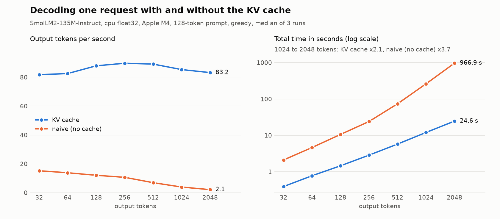

# Kiyal

Kiyal (Kyrgyz *кыял*, "dream") is an LLM inference engine and OpenAI-compatible server, built
from scratch in PyTorch.

## Status

Early development. Implemented so far:

- automatic device and dtype selection (CUDA, MPS or CPU)
- the Llama model: RMSNorm, rotary position embeddings, grouped-query attention and a SwiGLU MLP
- a strict safetensors loader for Hugging Face checkpoints, from a local directory or the Hub
- sampling with temperature, top-k, top-p, min-p, repetition, presence and frequency penalties,
  and per-request seeds, with settings batched per row
- streaming detokenization that never prints half a character, and stop strings matched across
  token boundaries
- a KV cache: the keys and values of every layer are kept in one preallocated tensor, so the
  prompt runs through the model once and each later step runs on a single new token
- static batching: prompts of different lengths are padded at the start into one batch, with the
  padding hidden from attention and positions counted per row, so each prompt gets the tokens it
  would get alone
- continuous batching: an engine with `add_request` and `step` whose scheduler rebuilds the batch
  at every step, first come, first served, within limits on sequences and tokens per step. A
  request leaves the batch as soon as its output ends and a waiting one takes its place. The
  tokens of all requests in a step run through the model flattened, without padding, and each
  request keeps its keys and values in its own row of a preallocated pool
- `kiyal generate`, which streams text decoded with the KV cache. The loop that recomputes the
  whole sequence at every step is kept as the baseline for tests and benchmarks.

On SmolLM2-135M-Instruct in fp32 on CPU, the model's logits match `transformers` within 1e-4, and
greedy generation for a chat prompt gives the same tokens as `transformers`' `generate()`. Decoding
with the KV cache gives the same tokens as decoding without it, and a static or continuous batch
gives each prompt the same tokens as decoding it alone. The server is not implemented yet.

## Setup

Requires [uv](https://docs.astral.sh/uv/). uv installs Python 3.12 if it is missing.

```sh
git clone https://github.com/doublepunch31/kiyal.git
cd kiyal
uv sync --extra cpu
uv run kiyal --help
```

The `cpu` extra installs PyTorch's CPU-only build on Linux and the standard build on macOS, which
runs on Apple Silicon GPUs through MPS. An install option for NVIDIA GPUs will be added with the
first GPU benchmarks.

## Usage

```sh
uv run kiyal generate --model HuggingFaceTB/SmolLM2-135M-Instruct "What is the capital of France?"
```

The prompt is wrapped in the model's chat template and the reply is printed as it is generated.
The model is downloaded into the Hugging Face cache on first use (about 270 MB).

```sh
# Continue plain text instead, greedily, up to the first full stop.
uv run kiyal generate --model HuggingFaceTB/SmolLM2-135M-Instruct \
    --raw --temperature 0 --stop "." "The capital of France is"
```

`uv run kiyal generate --help` lists the sampling options.

## Benchmarks

All numbers below were measured on a laptop (Apple M4): the KV cache and static batching runs
on battery power, the continuous batching runs on AC power. None are NVIDIA GPU numbers.

### KV cache

One request with a 128-token prompt, decoded greedily with and without the KV cache.
SmolLM2-135M-Instruct in fp32 on a laptop CPU (Apple M4), median of 3 runs. These are not GPU
numbers.



| output tokens | KV cache tokens/s | naive tokens/s | KV cache total s | naive total s | speedup |
|---|---|---|---|---|---|
| 32 | 81.8 | 15.2 | 0.39 | 2.10 | 5.4 |
| 64 | 82.5 | 13.8 | 0.78 | 4.63 | 6.0 |
| 128 | 87.9 | 12.1 | 1.46 | 10.60 | 7.3 |
| 256 | 89.6 | 10.7 | 2.86 | 24.01 | 8.4 |
| 512 | 89.1 | 7.0 | 5.75 | 73.57 | 12.8 |
| 1024 | 85.3 | 3.9 | 12.01 | 260.45 | 21.7 |
| 2048 | 83.2 | 2.1 | 24.62 | 966.92 | 39.3 |

With the cache, total time doubles when the output doubles. Without it, every step runs the model
on the whole sequence, so total time follows the sum of the sequence lengths: doubling the output
multiplies it by 2.2 for short outputs, where the 128-token prompt is most of the sequence, and by
3.7 from 1024 to 2048 tokens, close to the factor of 4 of quadratic growth.

### Static batching

B different 128-token prompts decoded together, 128 greedy output tokens each, with the KV cache.
Batch sizes 1 to 64, median of 3 runs after one warm-up at each size. A step gives every prompt
its next token, so the step time is also each prompt's time per output token.

On the M4 GPU through MPS (fp16):


| batch size | output tokens/s | x batch 1 | step ms | x batch 1 | TTFT ms |
|---|---|---|---|---|---|
| 1 | 108.4 | 1.00 | 9.0 | 1.00 | 31 |
| 2 | 173.6 | 1.60 | 11.3 | 1.25 | 43 |
| 4 | 331.6 | 3.06 | 11.6 | 1.28 | 73 |
| 8 | 583.7 | 5.38 | 12.7 | 1.41 | 134 |
| 16 | 812.8 | 7.50 | 17.8 | 1.96 | 264 |
| 32 | 1295.9 | 11.95 | 20.9 | 2.31 | 511 |
| 64 | 1829.1 | 16.87 | 27.3 | 3.02 | 1012 |

Much of a decoding step's cost does not grow with the batch: every weight is read once per step,
and the fixed cost of running each layer is paid once. Up to batch 8, extra rows share that cost
almost for free: 8 times the tokens per step for a step 1.4 times as long. From batch 16 the step time grows faster, and
batch 64 gives 16.9 times the throughput of batch 1 for steps 3 times as long. The time to the
first token grows with the batch, because every prompt is prefilled before the first step.

On the CPU (fp32, 4 threads):

| batch size | output tokens/s | x batch 1 | step ms | x batch 1 | TTFT ms |
|---|---|---|---|---|---|
| 1 | 92.1 | 1.00 | 10.5 | 1.00 | 53 |
| 2 | 62.7 | 0.68 | 31.4 | 2.99 | 83 |
| 4 | 127.5 | 1.38 | 30.5 | 2.90 | 138 |
| 8 | 186.6 | 2.03 | 41.1 | 3.90 | 271 |
| 16 | 369.1 | 4.01 | 39.5 | 3.75 | 531 |
| 32 | 604.0 | 6.56 | 44.9 | 4.27 | 1077 |
| 64 | 816.3 | 8.86 | 62.3 | 5.92 | 2127 |

Batch 2 is slower than batch 1 on the CPU. The time goes into the linear layers: with PyTorch's
Accelerate backend on this machine, multiplying 2 to 16 rows by a weight stored as [out, in]
took about 200 µs for a 1536 x 576 weight, against 8 µs for one row and 20 µs for the same rows
with the weight stored transposed. From batch 2 on, the step time grows slowly again.

### Continuous batching

64 requests arrive at once, with prompt lengths drawn from 32 to 256 tokens and output lengths
from 16 to 256 (seed 0), decoded greedily. Static batching takes them in arrival order, B at a
time, and runs each batch until its longest output ends. Continuous batching keeps up to B
requests in the batch and starts a waiting one as soon as another ends. Latency counts from
arrival to a request's last token. Median of 3 runs after one warm-up per engine and batch size.

On the M4 GPU through MPS (fp16):


| batch size | static tokens/s | continuous tokens/s | throughput x | static p50 s | continuous p50 s | static p99 s | continuous p99 s | static decode use |
|---|---|---|---|---|---|---|---|---|
| 8 | 254.0 | 371.3 | 1.46 | 20.5 | 15.5 | 38.8 | 26.4 | 67% |
| 16 | 362.4 | 530.5 | 1.46 | 13.7 | 11.6 | 26.8 | 18.5 | 62% |
| 32 | 516.0 | 709.2 | 1.37 | 10.9 | 9.0 | 19.0 | 13.8 | 61% |

With these output lengths, only 61% to 67% of static batching's decoding slots go to outputs
that have not ended ("decode use"); the rest compute tokens of finished outputs that are thrown
away, and requests in later batches wait for the whole batch before them. Continuous batching
gives 1.37 to 1.46 times the throughput, with a 27% to 32% lower p99 latency and a 16% to 24%
lower median. The gain stays below the 1.5 to 1.6 that the unused slots alone would allow: a
step that starts new prompts pauses every running output, and the last steps run with a
part-empty batch. Four further runs alternating the two engines at batch 16 gave 1.32 to 1.43.

On the CPU (fp32, 4 threads):

| batch size | static tokens/s | continuous tokens/s | throughput x | static p50 s | continuous p50 s | static p99 s | continuous p99 s |
|---|---|---|---|---|---|---|---|
| 8 | 92.5 | 117.3 | 1.27 | 54.2 | 47.8 | 106.4 | 83.9 |
| 16 | 175.0 | 210.5 | 1.20 | 29.6 | 30.2 | 55.1 | 46.8 |
| 32 | 269.4 | 308.3 | 1.14 | 20.5 | 18.8 | 36.4 | 31.9 |

CPU timings are noisier: static batching at batch 8 ran 25% slower than in an earlier session
with the same code, and four runs alternating the engines at batch 16 gave ratios from 1.31 to
1.61. Every timed continuous batching run was faster than every static batching run, on both
devices.

The first version of this benchmark made continuous batching slower than static batching. A
profile showed that each decode step spent more time copying the batch's KV cache rows out of
the pool than in attention itself (32 ms against 4 ms per step on MPS at batch 32). Decode steps
now read the rows in place.

The result files, the CPU charts and the full tables are in
[benchmarks/results/](benchmarks/results/).

## Development

```sh
uv run ruff format && uv run ruff check   # format and lint
uv run pyright                            # type-check
uv run pytest -m "not slow"               # fast tests
uv run pytest                             # all tests, including those that download weights
```

The slow tests compare against `transformers` on SmolLM2-135M-Instruct and download its weights
(about 270 MB) into the Hugging Face cache on first run. The fast tests use a tiny random model and
download nothing.

Every optimization is tested for equivalence with the simpler path it replaces. The KV cache is
the first step: at every decoding step the cached logits must match the uncached ones within a
tolerance, and greedy generation must give the same tokens. Steps where the two best tokens are
closer than twice the tolerance are near ties that rounding can flip, so the token comparison
stops at the first one. Static batching is the second: each row of a padded batch must match its
prompt decoded alone with the KV cache, in the same way. Continuous batching is the third: with
requests arriving at random steps and in random order, each must again match its prompt decoded
alone.

```sh
# Single-request decoding speed at several output lengths, saved as JSON in benchmarks/raw/.
# The naive engine takes over an hour on a laptop CPU at the default lengths.
uv run python -m benchmarks.latency --model HuggingFaceTB/SmolLM2-135M-Instruct --engine cached
uv run python -m benchmarks.latency --model HuggingFaceTB/SmolLM2-135M-Instruct --engine naive

# Chart (PNG) and table (markdown) from one result file per engine.
uv run python -m benchmarks.plot latency benchmarks/results/latency-*-cpu.json \
    --output benchmarks/results/latency-cpu

# Static batching throughput at batch sizes 1 to 64, then its chart and table.
uv run python -m benchmarks.throughput --model HuggingFaceTB/SmolLM2-135M-Instruct --device cpu
uv run python -m benchmarks.plot throughput benchmarks/results/throughput-static-cpu.json \
    --output benchmarks/results/throughput-cpu

# Static against continuous batching on 64 requests of random lengths, then the chart and table.
uv run python -m benchmarks.batching --model HuggingFaceTB/SmolLM2-135M-Instruct --device cpu
uv run python -m benchmarks.plot batching benchmarks/results/batching-cpu.json \
    --output benchmarks/results/batching-cpu
```

## License

MIT. See [LICENSE](LICENSE).
